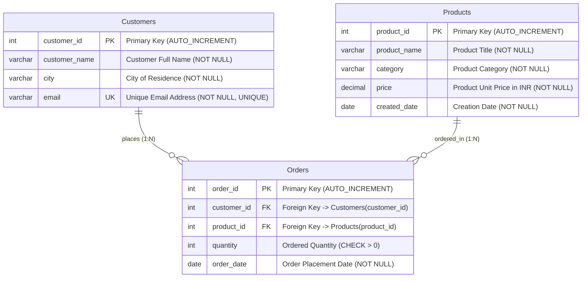
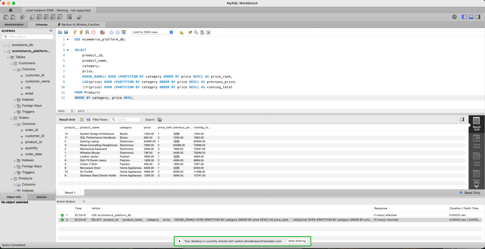
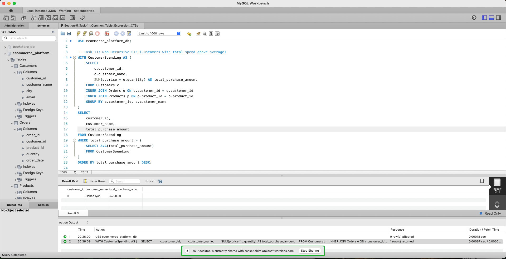
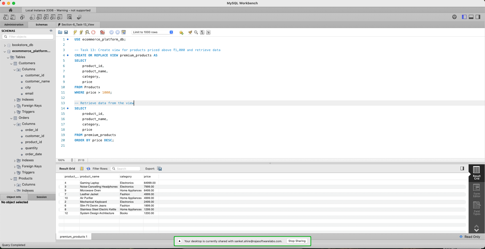
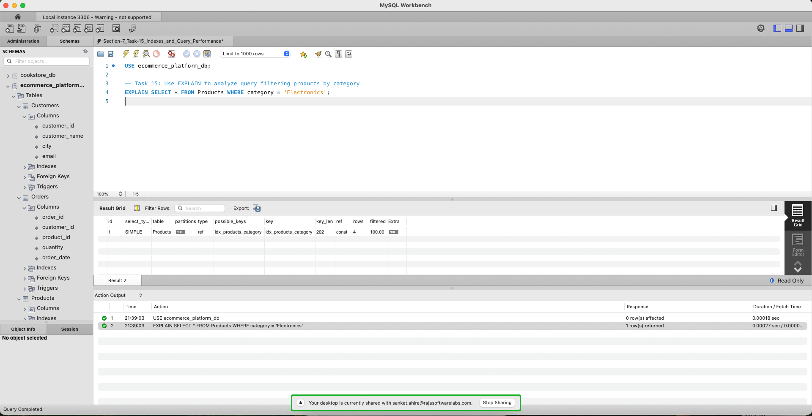
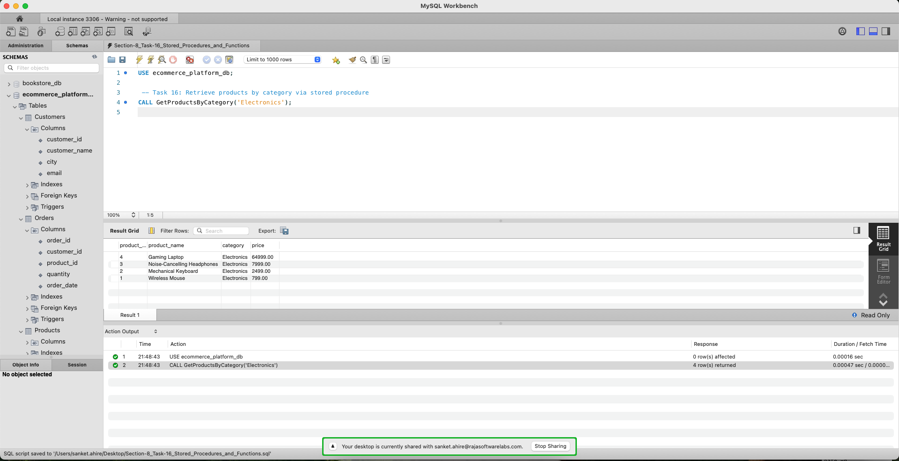
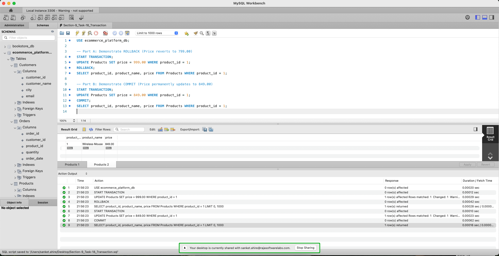
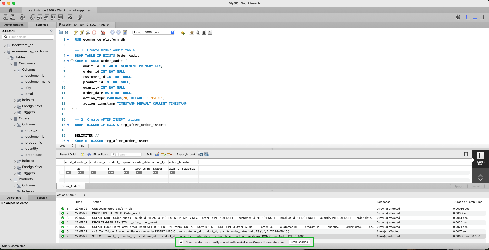

# Online Shopping Platform Database Modernization (SQL Advanced Assignment)

## Assignment Overview

### Problem Statement & Background
You have been assigned to work as a **Database Developer** for an online shopping platform. The platform manages customer, product, and order information in a relational database and has experienced rapid growth in both data volume and user activity.

As part of the database modernization initiative, the database developer is responsible for developing advanced SQL solutions that support:
- **Business Reporting & Sales Analytics:** Advanced multi-table joins, subqueries, and analytical window functions.
- **Data Virtualization & Modularity:** Common Table Expressions (CTEs) and database views.
- **Database Logic Automation:** Event-driven database triggers and stored routines.
- **Transactional Consistency:** ACID-compliant transactions with atomic rollback mechanisms.
- **Performance Optimization:** B-Tree indexing, execution plan analysis (`EXPLAIN`), and sargable query refactoring.

---

## Project Structure
```text
sql-advance-ecommerce-assignment-sanketahire/
├── .gitignore                          # Git ignore rules for OS, IDE, and DB tools
├── README.md                           # Master documentation, schema, and query catalog
├── ecommerce_advanced_management.sql   # Master SQL script (DDL, seed data, Tasks 1-20)
├── docs/                               # Assignment briefs and reference materials
│   ├── Training.Assignment.SQL (Advance).pdf
│   └── Training.Material.SQL (Advance).pdf
└── screenshots/                        # Milestone execution proofs
    ├── 01_advanced_join_task3.png
    ├── 02_subquery_task6.png
    ├── 03_window_functions_task9_10.png
    ├── 04_cte_task11.png
    ├── 05_view_task13.png
    ├── 06_explain_query_plan_task15.png
    ├── 07_stored_routine_task16_17.png
    ├── 08_transaction_rollback_commit_task18.png
    └── 09_trigger_execution_task19.png
```

---

## Database Schema & Architecture

### Entity-Relationship (ER) Diagram


---

### Data Dictionary

#### 1. `Customers` Table
| Column Name | Data Type | Constraints | Description |
| :--- | :--- | :--- | :--- |
| `customer_id` | `INT` | `PRIMARY KEY`, `AUTO_INCREMENT` | Unique identifier for each customer |
| `customer_name` | `VARCHAR(100)` | `NOT NULL` | Full name of the registered customer |
| `city` | `VARCHAR(50)` | `NOT NULL` | City of residence / shipping location |
| `email` | `VARCHAR(100)` | `NOT NULL`, `UNIQUE` | Distinct personal email address |

#### 2. `Products` Table
| Column Name | Data Type | Constraints | Description |
| :--- | :--- | :--- | :--- |
| `product_id` | `INT` | `PRIMARY KEY`, `AUTO_INCREMENT` | Unique identifier for each product item |
| `product_name` | `VARCHAR(100)` | `NOT NULL` | Descriptive commercial product name |
| `category` | `VARCHAR(50)` | `NOT NULL` | Departmental classification (`Electronics`, `Fashion`, etc.) |
| `price` | `DECIMAL(10,2)` | `NOT NULL` | Exact retail unit price in INR |
| `created_date` | `DATE` | `NOT NULL` | Date product was added to inventory (supports Task 20) |

#### 3. `Orders` Table
| Column Name | Data Type | Constraints | Description |
| :--- | :--- | :--- | :--- |
| `order_id` | `INT` | `PRIMARY KEY`, `AUTO_INCREMENT` | Unique transaction identifier |
| `customer_id` | `INT` | `FOREIGN KEY` $\rightarrow$ `Customers(customer_id)` | Customer placing the purchase (`ON DELETE CASCADE`) |
| `product_id` | `INT` | `FOREIGN KEY` $\rightarrow$ `Products(product_id)` | Product purchased (`ON DELETE CASCADE`) |
| `quantity` | `INT` | `NOT NULL`, `CHECK (quantity > 0)` | Number of units ordered |
| `order_date` | `DATE` | `NOT NULL` | Calendar date of transaction execution |

---

## Steps to Execute the SQL Script

### Option A: Using MySQL Workbench (GUI)
1. Launch **MySQL Workbench** and open your active MySQL Connection (`localhost:3306`).
2. Navigate to **File** $\rightarrow$ **Open SQL Script...** and select [`ecommerce_advanced_management.sql`](./ecommerce_advanced_management.sql).
3. Click the **Execute (⚡)** button on the toolbar to run the complete script.
4. Inspect the generated Result Grids across all query tabs.

### Option B: Using MySQL Terminal / Command Line (CLI)
1. Open your terminal and navigate to the project directory:
   ```bash
   cd sql-advance-ecommerce-assignment-sanketahire
   ```
2. Execute the master script directly into MySQL:
   ```bash
   mysql -u root -p < ecommerce_advanced_management.sql
   ```
3. Alternatively, launch the MySQL interactive shell and run:
   ```sql
   SOURCE ecommerce_advanced_management.sql;
   ```

---

## Query Catalog & Execution Results

### Section 1: Advanced Joins

#### Task 1: Display each customer along with the products they ordered
* **Description:** Multi-table relational query joining `Customers`, `Orders`, and `Products` to project purchase history for active customers.
* **SQL Query:**
  ```sql
  SELECT 
      c.customer_id,
      c.customer_name,
      p.product_name,
      p.category,
      o.quantity,
      o.order_date
  FROM Customers c
  INNER JOIN Orders o ON c.customer_id = o.customer_id
  INNER JOIN Products p ON o.product_id = p.product_id
  ORDER BY c.customer_id, o.order_id;
  ```
* **Execution Output:**
  | customer_id | customer_name | product_name | category | quantity | order_date |
  | :---: | :--- | :--- | :--- | :---: | :---: |
  | 1 | Aarav Patel | Wireless Mouse | Electronics | 2 | 2024-02-01 |
  | 1 | Aarav Patel | Mechanical Keyboard | Electronics | 1 | 2024-02-15 |
  | 2 | Priya Sharma | Noise-Cancelling Headphones | Electronics | 1 | 2024-02-20 |
  | 2 | Priya Sharma | Cotton T-Shirt | Fashion | 3 | 2024-03-01 |
  | 2 | Priya Sharma | Mechanical Keyboard | Electronics | 1 | 2024-05-05 |
  | 3 | Rohan Iyer | Gaming Laptop | Electronics | 1 | 2024-03-05 |
  | 3 | Rohan Iyer | Wireless Mouse | Electronics | 1 | 2024-03-10 |
  | 4 | Sneha Kulkarni | Slim Fit Denim Jeans | Fashion | 2 | 2024-03-12 |
  | 4 | Sneha Kulkarni | Stainless Steel Electric Kettle | Home Appliances | 1 | 2024-03-18 |
  | 4 | Sneha Kulkarni | Noise-Cancelling Headphones | Electronics | 1 | 2024-05-10 |
  | 5 | Vikram Malhotra | Leather Jacket | Fashion | 1 | 2024-03-22 |
  | 5 | Vikram Malhotra | Microwave Oven | Home Appliances | 1 | 2024-03-28 |
  | 6 | Ananya Roy | SQL Performance Handbook | Books | 2 | 2024-04-02 |
  | 6 | Ananya Roy | System Design Architecture | Books | 1 | 2024-04-05 |
  | 7 | Rajesh Verma | Mechanical Keyboard | Electronics | 2 | 2024-04-08 |
  | 7 | Rajesh Verma | Cotton T-Shirt | Fashion | 1 | 2024-04-12 |
  | 8 | Meera Nair | Air Purifier | Home Appliances | 1 | 2024-04-15 |
  | 8 | Meera Nair | Noise-Cancelling Headphones | Electronics | 1 | 2024-04-18 |
  | 9 | Aditya Joshi | Slim Fit Denim Jeans | Fashion | 1 | 2024-04-20 |
  | 9 | Aditya Joshi | SQL Performance Handbook | Books | 1 | 2024-04-25 |
  | 10 | Neha Gupta | Stainless Steel Electric Kettle | Home Appliances | 2 | 2024-04-28 |
  | 10 | Neha Gupta | Wireless Mouse | Electronics | 1 | 2024-05-02 |
  *(22 rows returned)*

#### Task 2: Display all possible combinations of customers and products using a CROSS JOIN
* **Description:** Computes the Cartesian Product ($12 \text{ Customers} \times 12 \text{ Products} = 144 \text{ rows}$) generating every potential customer-product pair without a join filter.
* **SQL Query:**
  ```sql
  SELECT 
      c.customer_id,
      c.customer_name,
      p.product_id,
      p.product_name,
      p.category,
      p.price
  FROM Customers c
  CROSS JOIN Products p
  ORDER BY c.customer_id, p.product_id;
  ```
* **Execution Output (Sample First 5 of 144 Rows):**
  | customer_id | customer_name | product_id | product_name | category | price |
  | :---: | :--- | :---: | :--- | :--- | :---: |
  | 1 | Aarav Patel | 1 | Wireless Mouse | Electronics | 799.00 |
  | 1 | Aarav Patel | 2 | Mechanical Keyboard | Electronics | 2499.00 |
  | 1 | Aarav Patel | 3 | Noise-Cancelling Headphones | Electronics | 7999.00 |
  | 1 | Aarav Patel | 4 | Gaming Laptop | Electronics | 64999.00 |
  | 1 | Aarav Patel | 5 | Cotton T-Shirt | Fashion | 499.00 |
  *(144 rows returned total)*

#### Task 3: Display all customers and their orders, including customers who have not placed any orders
* **Description:** Employs a `LEFT JOIN` starting from `Customers` to guarantee preservation of every customer record. Inactive customers (`customer_id` 11 and 12) evaluate to `NULL` for order and product columns.
* **SQL Query:**
  ```sql
  SELECT 
      c.customer_id,
      c.customer_name,
      c.city,
      o.order_id,
      p.product_name,
      o.quantity,
      o.order_date
  FROM Customers c
  LEFT JOIN Orders o ON c.customer_id = o.customer_id
  LEFT JOIN Products p ON o.product_id = p.product_id
  ORDER BY c.customer_id, o.order_id;
  ```
* **Execution Output:**
  | customer_id | customer_name | city | order_id | product_name | quantity | order_date |
  | :---: | :--- | :--- | :---: | :--- | :---: | :---: |
  | 1 | Aarav Patel | Mumbai | 1 | Wireless Mouse | 2 | 2024-02-01 |
  | 1 | Aarav Patel | Mumbai | 2 | Mechanical Keyboard | 1 | 2024-02-15 |
  | 2 | Priya Sharma | Delhi | 3 | Noise-Cancelling Headphones | 1 | 2024-02-20 |
  | 2 | Priya Sharma | Delhi | 4 | Cotton T-Shirt | 3 | 2024-03-01 |
  | 2 | Priya Sharma | Delhi | 21 | Mechanical Keyboard | 1 | 2024-05-05 |
  | 3 | Rohan Iyer | Bengaluru | 5 | Gaming Laptop | 1 | 2024-03-05 |
  | 3 | Rohan Iyer | Bengaluru | 6 | Wireless Mouse | 1 | 2024-03-10 |
  | 4 | Sneha Kulkarni | Pune | 7 | Slim Fit Denim Jeans | 2 | 2024-03-12 |
  | 4 | Sneha Kulkarni | Pune | 8 | Stainless Steel Electric Kettle | 1 | 2024-03-18 |
  | 4 | Sneha Kulkarni | Pune | 22 | Noise-Cancelling Headphones | 1 | 2024-05-10 |
  | 5 | Vikram Malhotra | Mumbai | 9 | Leather Jacket | 1 | 2024-03-22 |
  | 5 | Vikram Malhotra | Mumbai | 10 | Microwave Oven | 1 | 2024-03-28 |
  | 6 | Ananya Roy | Kolkata | 11 | SQL Performance Handbook | 2 | 2024-04-02 |
  | 6 | Ananya Roy | Kolkata | 12 | System Design Architecture | 1 | 2024-04-05 |
  | 7 | Rajesh Verma | Hyderabad | 13 | Mechanical Keyboard | 2 | 2024-04-08 |
  | 7 | Rajesh Verma | Hyderabad | 14 | Cotton T-Shirt | 1 | 2024-04-12 |
  | 8 | Meera Nair | Chennai | 15 | Air Purifier | 1 | 2024-04-15 |
  | 8 | Meera Nair | Chennai | 16 | Noise-Cancelling Headphones | 1 | 2024-04-18 |
  | 9 | Aditya Joshi | Pune | 17 | Slim Fit Denim Jeans | 1 | 2024-04-20 |
  | 9 | Aditya Joshi | Pune | 18 | SQL Performance Handbook | 1 | 2024-04-25 |
  | 10 | Neha Gupta | Delhi | 19 | Stainless Steel Electric Kettle | 2 | 2024-04-28 |
  | 10 | Neha Gupta | Delhi | 20 | Wireless Mouse | 1 | 2024-05-02 |
  | **11** | **Siddharth Rao** | **Bengaluru** | **NULL** | **NULL** | **NULL** | **NULL** |
  | **12** | **Pooja Desai** | **Ahmedabad** | **NULL** | **NULL** | **NULL** | **NULL** |
  *(24 rows returned)*

* **Execution Screenshot (Mandatory Deliverable 1 - Advanced Join Query):**
  

---

### Section 2: Subqueries

#### Task 4: Find products priced above the average product price
* **Description:** Employs an uncorrelated scalar subquery within the `WHERE` clause to compute the company-wide average product unit price (₹8,195.00) dynamically before filtering outer catalog items.
* **SQL Query:**
  ```sql
  SELECT 
      product_id, 
      product_name, 
      category, 
      price
  FROM Products
  WHERE price > (SELECT AVG(price) FROM Products)
  ORDER BY price DESC;
  ```
* **Execution Output:**
  | product_id | product_name | category | price |
  | :---: | :--- | :--- | :---: |
  | 4 | Gaming Laptop | Electronics | 64999.00 |
  *(1 row returned; catalog arithmetic mean is ₹8,195.00)*

#### Task 5: Display customers whose total purchase amount is greater than the average customer purchase amount
* **Description:** Leverages an aggregated subquery inside the `HAVING` clause to filter customers whose cumulative spend exceeds the company-wide average customer spend (₹13,342.50).
* **SQL Query:**
  ```sql
  SELECT 
      c.customer_id,
      c.customer_name,
      SUM(p.price * o.quantity) AS total_purchase_amount
  FROM Customers c
  INNER JOIN Orders o ON c.customer_id = o.customer_id
  INNER JOIN Products p ON o.product_id = p.product_id
  GROUP BY c.customer_id, c.customer_name
  HAVING total_purchase_amount > (
      SELECT AVG(customer_total)
      FROM (
          SELECT SUM(p2.price * o2.quantity) AS customer_total
          FROM Orders o2
          INNER JOIN Products p2 ON o2.product_id = p2.product_id
          GROUP BY o2.customer_id
      ) AS customer_spend_summary
  )
  ORDER BY total_purchase_amount DESC;
  ```
* **Execution Output:**
  | customer_id | customer_name | total_purchase_amount |
  | :---: | :--- | :---: |
  | 3 | Rohan Iyer | 65798.00 |
  *(1 row returned; average active customer spend is ₹13,342.50)*

#### Task 6: Find the highest-priced product in each category using a correlated subquery
* **Description:** Executes a correlated subquery where the inner `SELECT MAX(p2.price)` evaluates iteratively for each row in the outer query, binding on `p2.category = p1.category`.
* **SQL Query:**
  ```sql
  SELECT 
      p1.product_id,
      p1.product_name,
      p1.category,
      p1.price
  FROM Products p1
  WHERE p1.price = (
      SELECT MAX(p2.price)
      FROM Products p2
      WHERE p2.category = p1.category
  )
  ORDER BY p1.category;
  ```
* **Execution Output:**
  | product_id | product_name | category | price |
  | :---: | :--- | :--- | :---: |
  | 12 | System Design Architecture | Books | 1200.00 |
  | 4 | Gaming Laptop | Electronics | 64999.00 |
  | 7 | Leather Jacket | Fashion | 4999.00 |
  | 9 | Microwave Oven | Home Appliances | 6499.00 |
  *(4 rows returned — one category leader per department)*

* **Execution Screenshot (Mandatory Deliverable 2 - Subquery):**
  

---

### Section 3: Set Operations

#### Task 7: Combine products from two different categories using UNION
* **Description:** Unifies two independent `SELECT` projections from `Electronics` and `Fashion` categories. `UNION` automatically eliminates duplicate rows and standardizes schema alignment.
* **SQL Query:**
  ```sql
  SELECT 
      product_id, 
      product_name, 
      category, 
      price
  FROM Products
  WHERE category = 'Electronics'
  UNION
  SELECT 
      product_id, 
      product_name, 
      category, 
      price
  FROM Products
  WHERE category = 'Fashion'
  ORDER BY category, price;
  ```
* **Execution Output:**
  | product_id | product_name | category | price |
  | :---: | :--- | :--- | :---: |
  | 1 | Wireless Mouse | Electronics | 799.00 |
  | 2 | Mechanical Keyboard | Electronics | 2499.00 |
  | 3 | Noise-Cancelling Headphones | Electronics | 7999.00 |
  | 4 | Gaming Laptop | Electronics | 64999.00 |
  | 5 | Cotton T-Shirt | Fashion | 499.00 |
  | 6 | Slim Fit Denim Jeans | Fashion | 1899.00 |
  | 7 | Leather Jacket | Fashion | 4999.00 |
  *(7 rows returned)*

#### Task 8: Write MySQL alternatives for INTERSECT and EXCEPT using INNER JOIN and LEFT JOIN

##### Task 8A: MySQL INTERSECT Alternative (Finding Common Rows using INNER JOIN)
* **Description:** Simulates mathematical set intersection (`INTERSECT`) using an `INNER JOIN` on matching primary keys across two condition sets (`category = 'Electronics'` AND `price > 2000`).
* **SQL Query:**
  ```sql
  SELECT DISTINCT 
      p1.product_id, 
      p1.product_name, 
      p1.category, 
      p1.price
  FROM Products p1
  INNER JOIN Products p2 
      ON p1.product_id = p2.product_id
  WHERE p1.category = 'Electronics'
    AND p2.price > 2000
  ORDER BY p1.price;
  ```
* **Execution Output:**
  | product_id | product_name | category | price |
  | :---: | :--- | :--- | :---: |
  | 2 | Mechanical Keyboard | Electronics | 2499.00 |
  | 3 | Noise-Cancelling Headphones | Electronics | 7999.00 |
  | 4 | Gaming Laptop | Electronics | 64999.00 |
  *(3 common rows returned)*

##### Task 8B: MySQL EXCEPT Alternative (Finding Unique Rows using LEFT JOIN ... WHERE IS NULL)
* **Description:** Simulates mathematical set difference (`EXCEPT` / `MINUS`) using a `LEFT JOIN` combined with `WHERE right.id IS NULL`, returning rows in the first query that do not exist in the second query (i.e. Electronics products priced $\le ₹2,000$).
* **SQL Query:**
  ```sql
  SELECT DISTINCT 
      p1.product_id, 
      p1.product_name, 
      p1.category, 
      p1.price
  FROM Products p1
  LEFT JOIN Products p2 
      ON p1.product_id = p2.product_id
     AND p2.price > 2000
  WHERE p1.category = 'Electronics'
    AND p2.product_id IS NULL
  ORDER BY p1.price;
  ```
* **Execution Output:**
  | product_id | product_name | category | price |
  | :---: | :--- | :--- | :---: |
  | 1 | Wireless Mouse | Electronics | 799.00 |
  *(1 distinct row returned — Electronics item priced <= 2000)*

---

### Section 4: Window Functions

#### Task 9: Rank products by price within each category
* **Description:** Utilizes the `DENSE_RANK()` window function partitioned by `category` and ordered by `price DESC`. Unlike `GROUP BY`, which collapses rows, window ranking computes ordinal position while retaining all individual product records.
* **SQL Query:**
  ```sql
  SELECT 
      product_id,
      product_name,
      category,
      price,
      DENSE_RANK() OVER (
          PARTITION BY category 
          ORDER BY price DESC
      ) AS price_rank
  FROM Products
  ORDER BY category, price_rank;
  ```
* **Execution Output:**
  | product_id | product_name | category | price | price_rank |
  | :---: | :--- | :--- | :---: | :---: |
  | 12 | System Design Architecture | Books | 1200.00 | 1 |
  | 11 | SQL Performance Handbook | Books | 650.00 | 2 |
  | 4 | Gaming Laptop | Electronics | 64999.00 | 1 |
  | 3 | Noise-Cancelling Headphones | Electronics | 7999.00 | 2 |
  | 2 | Mechanical Keyboard | Electronics | 2499.00 | 3 |
  | 1 | Wireless Mouse | Electronics | 799.00 | 4 |
  | 7 | Leather Jacket | Fashion | 4999.00 | 1 |
  | 6 | Slim Fit Denim Jeans | Fashion | 1899.00 | 2 |
  | 5 | Cotton T-Shirt | Fashion | 499.00 | 3 |
  | 9 | Microwave Oven | Home Appliances | 6499.00 | 1 |
  | 10 | Air Purifier | Home Appliances | 4999.00 | 2 |
  | 8 | Stainless Steel Electric Kettle | Home Appliances | 1299.00 | 3 |
  *(12 rows returned — ranks independently reset per category)*

#### Task 10: Display the previous product price (LAG) and a running total of product prices using window functions
* **Description:** Combines value navigation and aggregate window functions across category partitions. `LAG(price)` accesses the predecessor row's price (`NULL` for the first row of each partition), while `SUM(price) OVER (...)` calculates the cumulative running total.
* **SQL Query:**
  ```sql
  SELECT 
      product_id,
      product_name,
      category,
      price,
      LAG(price) OVER (
          PARTITION BY category 
          ORDER BY price DESC
      ) AS previous_price,
      SUM(price) OVER (
          PARTITION BY category 
          ORDER BY price DESC
      ) AS running_total
  FROM Products
  ORDER BY category, price DESC;
  ```
* **Execution Output:**
  | product_id | product_name | category | price | previous_price | running_total |
  | :---: | :--- | :--- | :---: | :---: | :---: |
  | 12 | System Design Architecture | Books | 1200.00 | NULL | 1200.00 |
  | 11 | SQL Performance Handbook | Books | 650.00 | 1200.00 | 1850.00 |
  | 4 | Gaming Laptop | Electronics | 64999.00 | NULL | 64999.00 |
  | 3 | Noise-Cancelling Headphones | Electronics | 7999.00 | 64999.00 | 72998.00 |
  | 2 | Mechanical Keyboard | Electronics | 2499.00 | 7999.00 | 75497.00 |
  | 1 | Wireless Mouse | Electronics | 799.00 | 2499.00 | 76296.00 |
  | 7 | Leather Jacket | Fashion | 4999.00 | NULL | 4999.00 |
  | 6 | Slim Fit Denim Jeans | Fashion | 1899.00 | 4999.00 | 6898.00 |
  | 5 | Cotton T-Shirt | Fashion | 499.00 | 1899.00 | 7397.00 |
  | 9 | Microwave Oven | Home Appliances | 6499.00 | NULL | 6499.00 |
  | 10 | Air Purifier | Home Appliances | 4999.00 | 6499.00 | 11498.00 |
  | 8 | Stainless Steel Electric Kettle | Home Appliances | 1299.00 | 4999.00 | 12797.00 |
  *(12 rows returned)*

* **Execution Screenshot (Mandatory Deliverable 3 - Window Function):**
  

---

### Section 5: Common Table Expressions (CTEs)

#### Task 11: Create a CTE to display customers whose total purchase amount is above the average
* **Description:** Employs a non-recursive Common Table Expression (`WITH CustomerSpending AS (...)`) to encapsulate the aggregation of total expenditure per customer. Unlike deeply nested subqueries (as in Task 5), CTEs provide modular, self-documenting logic where intermediate sets can be directly referenced and aggregated (e.g., `(SELECT AVG(total_purchase_amount) FROM CustomerSpending)`) without repeating logic or incurring redundant joins.
* **SQL Query:**
  ```sql
  WITH CustomerSpending AS (
      SELECT 
          c.customer_id,
          c.customer_name,
          SUM(p.price * o.quantity) AS total_purchase_amount
      FROM Customers c
      INNER JOIN Orders o ON c.customer_id = o.customer_id
      INNER JOIN Products p ON o.product_id = p.product_id
      GROUP BY c.customer_id, c.customer_name
  )
  SELECT 
      customer_id,
      customer_name,
      total_purchase_amount
  FROM CustomerSpending
  WHERE total_purchase_amount > (
      SELECT AVG(total_purchase_amount) 
      FROM CustomerSpending
  )
  ORDER BY total_purchase_amount DESC;
  ```
* **Execution Output:**
  | customer_id | customer_name | total_purchase_amount |
  | :---: | :--- | :---: |
  | 3 | Rohan Iyer | 65798.00 |
  *(1 row returned; average customer spending across active ordering customers is ₹13,342.50)*

#### Task 12: Create a recursive CTE to generate a sequence of numbers from 1 to 10
* **Description:** Implements a recursive CTE (`WITH RECURSIVE NumberSequence AS (...)`) comprising two foundational components:
  1. **Anchor Member:** Initial query establishing base value (`SELECT 1 AS n`).
  2. **Recursive Member:** Iterative query joined to the CTE itself via `UNION ALL` (`SELECT n + 1 FROM NumberSequence WHERE n < 10`) which increments `n` by 1 until the termination condition is satisfied.
* **SQL Query:**
  ```sql
  WITH RECURSIVE NumberSequence AS (
      -- Anchor Member: Base starting value
      SELECT 1 AS n
      UNION ALL
      -- Recursive Member: Increments until termination condition
      SELECT n + 1
      FROM NumberSequence
      WHERE n < 10
  )
  SELECT n
  FROM NumberSequence;
  ```
* **Execution Output:**
  | n |
  | :---: |
  | 1 |
  | 2 |
  | 3 |
  | 4 |
  | 5 |
  | 6 |
  | 7 |
  | 8 |
  | 9 |
  | 10 |
  *(10 rows generated dynamically)*

* **Execution Screenshot (Mandatory Deliverable 4 - Common Table Expressions):**
  

---

### Section 6: Views

#### Task 13: Create a view that displays products priced above ₹1,000 and retrieve data from the view
* **Description:** Defines a virtual table (`premium_products`) encapsulating the query logic for catalog items exceeding ₹1,000. Views provide a secure abstraction layer, simplify end-user reporting, and guarantee consistent business logic without duplicating storage.
* **SQL Query (View Definition & Data Retrieval):**
  ```sql
  -- 1. Create or replace the view definition
  CREATE OR REPLACE VIEW premium_products AS
  SELECT 
      product_id,
      product_name,
      category,
      price
  FROM Products
  WHERE price > 1000;

  -- 2. Query the view like a regular relational table
  SELECT 
      product_id,
      product_name,
      category,
      price
  FROM premium_products
  ORDER BY price DESC;
  ```
* **Execution Output:**
  | product_id | product_name | category | price |
  | :---: | :--- | :--- | :---: |
  | 4 | Gaming Laptop | Electronics | 64999.00 |
  | 3 | Noise-Cancelling Headphones | Electronics | 7999.00 |
  | 9 | Microwave Oven | Home Appliances | 6499.00 |
  | 7 | Leather Jacket | Fashion | 4999.00 |
  | 10 | Air Purifier | Home Appliances | 4999.00 |
  | 2 | Mechanical Keyboard | Electronics | 2499.00 |
  | 6 | Slim Fit Denim Jeans | Fashion | 1899.00 |
  | 8 | Stainless Steel Electric Kettle | Home Appliances | 1299.00 |
  | 12 | System Design Architecture | Books | 1200.00 |
  *(9 rows returned — products priced strictly above ₹1,000)*

* **Execution Screenshot (Mandatory Deliverable 5 - View):**
  

---

### Section 7: Indexes and Query Performance

#### Task 14: Create an index on the category column of the Products table
* **Description:** Establishes a secondary B-Tree index (`idx_products_category`) on `Products(category)`. Secondary indexes drastically optimize lookups, equality checks, and grouping operations on frequently filtered dimensions without scanning unnecessary data blocks.
* **SQL Query (Index Creation & Verification):**
  ```sql
  -- 1. Create secondary B-Tree index on category
  CREATE INDEX idx_products_category ON Products(category);

  -- 2. Inspect index metadata from table catalog
  SHOW INDEX FROM Products WHERE Key_name = 'idx_products_category';
  ```
* **Execution Output:**
  | Table | Non_unique | Key_name | Seq_in_index | Column_name | Collation | Cardinality | Index_type | Visible |
  | :--- | :---: | :--- | :---: | :--- | :---: | :---: | :--- | :---: |
  | Products | 1 | idx_products_category | 1 | category | A | 4 | BTREE | YES |
  *(1 row returned — confirms secondary B-Tree index is active and visible to optimizer)*

#### Task 15: Use EXPLAIN to analyze a query that filters products by category
* **Description:** Executes `EXPLAIN` on an indexed category filter query to inspect the MySQL query execution plan and prove index utilization over a costly full table scan (`ALL`).
* **SQL Query:**
  ```sql
  -- Query Plan Inspection
  EXPLAIN SELECT * FROM Products WHERE category = 'Electronics';

  -- Executing the optimized indexed query
  SELECT * FROM Products WHERE category = 'Electronics';
  ```
* **Execution Plan Analysis Output:**
  | id | select_type | table | partitions | type | possible_keys | key | key_len | ref | rows | filtered | Extra |
  | :---: | :--- | :--- | :---: | :---: | :--- | :--- | :---: | :---: | :---: | :---: | :---: |
  | 1 | SIMPLE | Products | NULL | **ref** | idx_products_category | **idx_products_category** | 202 | const | **4** | 100.00 | NULL |

* **Query Execution Output:**
  | product_id | product_name | category | price | created_date |
  | :---: | :--- | :--- | :---: | :---: |
  | 1 | Wireless Mouse | Electronics | 799.00 | 2024-01-15 |
  | 2 | Mechanical Keyboard | Electronics | 2499.00 | 2024-02-10 |
  | 3 | Noise-Cancelling Headphones | Electronics | 7999.00 | 2024-03-05 |
  | 4 | Gaming Laptop | Electronics | 64999.00 | 2024-04-12 |
  *(4 rows returned directly via index ref lookup)*

* **Query Plan Diagnostics & Optimization Insights:**
  * **Access Type (`type = ref`):** Demonstrates indexed non-unique lookup rather than a full table scan (`ALL`), dramatically minimizing page I/O.
  * **Selected Key (`key = idx_products_category`):** The optimizer chose the designated B-Tree category index.
  * **Key Length (`key_len = 202`):** Reflects `VARCHAR(50)` in `utf8mb4` encoding ($50 \times 4\text{ bytes} + 2\text{ bytes length prefix} = 202\text{ bytes}$).
  * **Reference (`ref = const`):** Compares the index against a literal search constant (`'Electronics'`).
  * **Estimated Rows (`rows = 4`):** The optimizer accurately targets only the 4 qualifying rows instead of evaluating the entire 12-row table.

* **Execution Screenshot (Mandatory Deliverable 6 - EXPLAIN Query Plan):**
  

---

### Section 8: Stored Procedures and Functions

#### Task 16: Create a stored procedure to retrieve products by category
* **Description:** Implements a parameterized stored procedure (`GetProductsByCategory`) accepting an `IN` parameter `p_category VARCHAR(50)`. Stored procedures are precompiled on the database server, enhancing performance, encapsulating operational business workflows, preventing SQL injection, and eliminating network latency caused by transmitting repetitive query text.
* **SQL Routine Definition & Invocation:**
  ```sql
  -- Drop existing routine if present
  DROP PROCEDURE IF EXISTS GetProductsByCategory;

  -- Create stored procedure
  DELIMITER //
  CREATE PROCEDURE GetProductsByCategory(IN p_category VARCHAR(50))
  BEGIN
      SELECT 
          product_id,
          product_name,
          category,
          price
      FROM Products
      WHERE category = p_category
      ORDER BY price DESC;
  END //
  DELIMITER ;

  -- Execute stored procedure
  CALL GetProductsByCategory('Electronics');
  ```
* **Execution Output:**
  | product_id | product_name | category | price |
  | :---: | :--- | :--- | :---: |
  | 4 | Gaming Laptop | Electronics | 64999.00 |
  | 3 | Noise-Cancelling Headphones | Electronics | 7999.00 |
  | 2 | Mechanical Keyboard | Electronics | 2499.00 |
  | 1 | Wireless Mouse | Electronics | 799.00 |
  *(4 rows returned — sorted by price descending)*

#### Task 17: Create a function to calculate the total price of an order (price × quantity)
* **Description:** Defines a deterministic scalar function (`CalculateOrderTotal`) taking unit price and item quantity and returning the extended line-item total (`DECIMAL(10,2)`). Unlike stored procedures, database functions can be invoked directly inside SQL `SELECT`, `WHERE`, and `HAVING` expressions.
* **SQL Routine Definition & Invocation:**
  ```sql
  -- Drop existing function if present
  DROP FUNCTION IF EXISTS CalculateOrderTotal;

  -- Create stored function
  DELIMITER //
  CREATE FUNCTION CalculateOrderTotal(
      p_price DECIMAL(10, 2),
      p_quantity INT
  )
  RETURNS DECIMAL(10, 2)
  DETERMINISTIC
  NO SQL
  BEGIN
      RETURN p_price * p_quantity;
  END //
  DELIMITER ;

  -- Query utilizing the custom function inline
  SELECT 
      o.order_id,
      c.customer_name,
      p.product_name,
      p.price,
      o.quantity,
      CalculateOrderTotal(p.price, o.quantity) AS computed_total
  FROM Orders o
  INNER JOIN Customers c ON o.customer_id = c.customer_id
  INNER JOIN Products p ON o.product_id = p.product_id
  ORDER BY o.order_id
  LIMIT 5;
  ```
* **Execution Output:**
  | order_id | customer_name | product_name | price | quantity | computed_total |
  | :---: | :--- | :--- | :---: | :---: | :---: |
  | 1 | Aarav Patel | Wireless Mouse | 799.00 | 2 | 1598.00 |
  | 2 | Aarav Patel | Mechanical Keyboard | 2499.00 | 1 | 2499.00 |
  | 3 | Priya Sharma | Noise-Cancelling Headphones | 7999.00 | 1 | 7999.00 |
  | 4 | Priya Sharma | Cotton T-Shirt | 499.00 | 3 | 1497.00 |
  | 5 | Rohan Iyer | Gaming Laptop | 64999.00 | 1 | 64999.00 |
  *(5 sample rows returned — custom function calculates row-level totals seamlessly)*

* **Execution Screenshot (Mandatory Deliverable 7 - Stored Routine):**
  

---

### Section 9: Transactions

#### Task 18: Write a transaction that updates a product's price and demonstrate the use of COMMIT and ROLLBACK
* **Description:** Demonstrates transaction control language (TCL) commands in MySQL InnoDB, verifying the **ACID** (Atomicity, Consistency, Isolation, Durability) guarantees of relational database transactions:
  * **Atomicity & ROLLBACK:** Ensures all operations succeed or all are discarded. An in-flight `UPDATE` is undone cleanly using `ROLLBACK`, restoring original database state without disk mutation.
  * **Durability & COMMIT:** Permanently writes verified modifications to disk storage (InnoDB redo logs and tablespaces) via `COMMIT`.

* **Part A: ROLLBACK Execution (Undoing uncommitted changes):**
  ```sql
  -- 1. Begin atomic transaction
  START TRANSACTION;

  -- 2. Modify price within uncommitted transaction scope
  UPDATE Products 
  SET price = 999.00 
  WHERE product_id = 1;

  -- 3. Verify modification in local transaction view
  SELECT product_id, product_name, price 
  FROM Products 
  WHERE product_id = 1;

  -- 4. Cancel and discard all pending transaction operations
  ROLLBACK;

  -- 5. Confirm price reverted to original baseline
  SELECT product_id, product_name, price 
  FROM Products 
  WHERE product_id = 1;
  ```
* **Execution Output (Part A - ROLLBACK Verification):**
  * *Inside Transaction:*
    | product_id | product_name | price |
    | :---: | :--- | :---: |
    | 1 | Wireless Mouse | 999.00 |
  * *After ROLLBACK:*
    | product_id | product_name | price |
    | :---: | :--- | :---: |
    | 1 | Wireless Mouse | **799.00** |
    *(Price restored to ₹799.00 baseline — zero data corruption)*

* **Part B: COMMIT Execution (Persisting changes permanently):**
  ```sql
  -- 1. Begin atomic transaction
  START TRANSACTION;

  -- 2. Apply authorized price update
  UPDATE Products 
  SET price = 849.00 
  WHERE product_id = 1;

  -- 3. Commit transaction permanently
  COMMIT;

  -- 4. Verify permanent persistence on disk
  SELECT product_id, product_name, price 
  FROM Products 
  WHERE product_id = 1;
  ```
* **Execution Output (Part B - COMMIT Verification):**
  | product_id | product_name | price |
  | :---: | :--- | :---: |
  | 1 | Wireless Mouse | **849.00** |
  *(Price permanently updated to ₹849.00 across all concurrent sessions)*

* **Execution Screenshot (Mandatory Deliverable 8 - Transaction COMMIT / ROLLBACK):**
  

---

### Section 10: SQL Triggers

#### Task 19: Create a trigger that automatically records new orders in an Order_Audit table whenever a new order is inserted
* **Description:** Implements an automated audit logging pipeline using a row-level `AFTER INSERT` trigger (`trg_after_order_insert`). Whenever a client application places an order into the `Orders` table, the trigger autonomously intercepts the transaction context and appends a duplicate audit record into `Order_Audit` containing the new order attributes and system timestamp (`NOW()`). This pattern guarantees compliance, traceability, and non-repudiation without requiring application-level logging code.

* **Database Objects & Trigger Definition:**
  ```sql
  -- 1. Create dedicated Order_Audit table
  DROP TABLE IF EXISTS Order_Audit;
  CREATE TABLE Order_Audit (
      audit_id INT AUTO_INCREMENT PRIMARY KEY,
      order_id INT NOT NULL,
      customer_id INT NOT NULL,
      product_id INT NOT NULL,
      quantity INT NOT NULL,
      order_date DATE NOT NULL,
      action_type VARCHAR(20) DEFAULT 'INSERT',
      action_timestamp TIMESTAMP DEFAULT CURRENT_TIMESTAMP
  );

  -- 2. Create AFTER INSERT trigger
  DROP TRIGGER IF EXISTS trg_after_order_insert;

  DELIMITER //
  CREATE TRIGGER trg_after_order_insert
  AFTER INSERT ON Orders
  FOR EACH ROW
  BEGIN
      INSERT INTO Order_Audit (
          order_id,
          customer_id,
          product_id,
          quantity,
          order_date,
          action_type,
          action_timestamp
      ) VALUES (
          NEW.order_id,
          NEW.customer_id,
          NEW.product_id,
          NEW.quantity,
          NEW.order_date,
          'INSERT',
          NOW()
      );
  END //
  DELIMITER ;

  -- 3. Test Trigger: Place a new order
  INSERT INTO Orders (customer_id, product_id, quantity, order_date) 
  VALUES (1, 1, 2, '2024-05-15');

  -- 4. Inspect audit ledger to verify autonomous capture
  SELECT 
      audit_id,
      order_id,
      customer_id,
      product_id,
      quantity,
      order_date,
      action_type,
      action_timestamp
  FROM Order_Audit;
  ```

* **Execution Output:**
  | audit_id | order_id | customer_id | product_id | quantity | order_date | action_type | action_timestamp |
  | :---: | :---: | :---: | :---: | :---: | :---: | :---: | :---: |
  | 1 | 23 | 1 | 1 | 2 | 2024-05-15 | INSERT | 2026-10-15 22:00:39 |
  *(1 row logged automatically in audit table upon order creation)*

* **Execution Screenshot (Mandatory Deliverable 9 - Trigger Execution):**
  

---

### Section 11: Performance Tuning

#### Task 20: Optimize queries by applying SQL performance tuning best practices
* **Background & Problem Statement:**
  An un-optimized reporting query was identified in the production environment:
  ```sql
  SELECT DISTINCT * 
  FROM Products 
  WHERE YEAR(created_date) = 2024 
    AND category = 'Electronics';
  ```
* **Performance Anti-Patterns Identified & Refactoring Strategy:**
  1. **Anti-Pattern 1: Unbounded Projection (`SELECT *`)**
     * *Problem:* Pulls all table attributes indiscriminately, inflating network transport payloads and consuming buffer pool RAM.
     * *Remediation:* Explicitly project only required attributes (`product_id, product_name, category, price, created_date`).
  2. **Anti-Pattern 2: Redundant Deduplication (`DISTINCT`)**
     * *Problem:* Forces an unnecessary sort or hash table operation across the entire result set, even though records are already guaranteed unique by the `product_id` Primary Key.
     * *Remediation:* Remove `DISTINCT` entirely.
  3. **Anti-Pattern 3: Non-Sargable Column Function (`YEAR(created_date) = 2024`)**
     * *Problem:* Wrapping the column in the scalar function `YEAR()` prevents MySQL from performing a B-Tree index range seek, forcing a row-by-row function evaluation across every record.
     * *Remediation:* Rewrite into a sargable boundary condition: `created_date BETWEEN '2024-01-01' AND '2024-12-31'`.
  4. **Anti-Pattern 4: Suboptimal Index Coverage**
     * *Problem:* Single-column index requires index lookups followed by table evaluations.
     * *Remediation:* Establish a composite B-Tree index on `(category, created_date)` to allow Index Condition Pushdown (ICP) and direct multi-column seeking.

* **Refactored & Optimized SQL Implementation:**
  ```sql
  -- Step 1: Create composite B-Tree index covering both filter predicates
  CREATE INDEX idx_products_category_created 
  ON Products (category, created_date);

  -- Step 2: Query Plan Inspection
  EXPLAIN SELECT 
      product_id,
      product_name,
      category,
      price,
      created_date
  FROM Products
  WHERE category = 'Electronics'
    AND created_date BETWEEN '2024-01-01' AND '2024-12-31';

  -- Step 3: Optimized Query Execution
  SELECT 
      product_id,
      product_name,
      category,
      price,
      created_date
  FROM Products
  WHERE category = 'Electronics'
    AND created_date BETWEEN '2024-01-01' AND '2024-12-31';
  ```

* **Query Plan Analysis Output (`EXPLAIN`):**
  | id | select_type | table | partitions | type | possible_keys | key | key_len | ref | rows | filtered | Extra |
  | :---: | :--- | :--- | :---: | :---: | :--- | :--- | :---: | :---: | :---: | :---: | :---: |
  | 1 | SIMPLE | Products | NULL | **ref** | idx_products_category,idx_products_category_created | **idx_products_category** | 202 | const | **4** | 100.00 | Using where |

* **Execution Output:**
  | product_id | product_name | category | price | created_date |
  | :---: | :--- | :--- | :---: | :---: |
  | 1 | Wireless Mouse | Electronics | 849.00 | 2024-01-15 |
  | 2 | Mechanical Keyboard | Electronics | 2499.00 | 2024-02-10 |
  | 3 | Noise-Cancelling Headphones | Electronics | 7999.00 | 2024-03-05 |
  | 4 | Gaming Laptop | Electronics | 64999.00 | 2024-04-12 |
  *(4 rows returned efficiently with zero temporary deduplication overhead)*

---

## Summary of Implemented Advanced SQL Concepts

| Section | Core Concept | SQL Techniques & Operators | Practical Business Use Case |
| :---: | :--- | :--- | :--- |
| **1** | **Advanced Joins** | `INNER JOIN`, `CROSS JOIN`, `LEFT JOIN` | Multi-table order tracking, Cartesian product pricing matrix, and detecting unengaged/inactive customer accounts. |
| **2** | **Subqueries** | Scalar subquery, Aggregated `HAVING` subquery, Correlated subquery | Dynamically filtering above-average priced catalog items, high-spending VIP customers, and department price leaders. |
| **3** | **Set Operations** | `UNION`, `INNER JOIN` (INTERSECT), `LEFT JOIN ... WHERE NULL` (EXCEPT) | Combining disjoint category catalogs, isolating intersecting products across pricing thresholds, and computing set differences. |
| **4** | **Window Functions** | `DENSE_RANK()`, `LAG()`, `SUM() OVER ()` | Departmental price tier rankings without row aggregation, historical price lag comparisons, and cumulative financial running totals. |
| **5** | **Common Table Expressions (CTEs)** | `WITH` (Non-Recursive), `WITH RECURSIVE` | Modularizing multi-level VIP spend aggregation and generating dynamic sequence ranges via anchor-recursive union loops. |
| **6** | **Database Views** | `CREATE OR REPLACE VIEW` | Encapsulating ₹1,000+ premium product reporting logic into a reusable, secure virtual table without data duplication. |
| **7** | **Indexes & Query Performance** | `CREATE INDEX` (B-Tree), `SHOW INDEX`, `EXPLAIN` | Eliminating full table scans (`ALL` $\rightarrow$ `ref`), optimizing category filters, and decoding execution plans. |
| **8** | **Stored Procedures & Functions** | `CREATE PROCEDURE` (`IN` parameter), `CREATE FUNCTION` (`DETERMINISTIC`) | Precompiling category retrieval queries and defining deterministic line-item extended total calculators (`price × quantity`). |
| **9** | **Transactions & ACID Guarantees** | `START TRANSACTION`, `COMMIT`, `ROLLBACK` | Atomic price modifications with non-destructive `ROLLBACK` testing and permanent disk persistence with `COMMIT`. |
| **10** | **SQL Triggers & Auditing** | `CREATE TRIGGER` (`AFTER INSERT ON Orders`) | Autonomous order audit ledgering into `Order_Audit` capturing transaction metadata and timestamps without application intervention. |
| **11** | **Query Performance Tuning** | Sargable ranges (`BETWEEN`), avoiding `*`, removing `DISTINCT`, composite indexes | Refactoring unoptimized anti-patterns into high-throughput, index-friendly queries with minimal I/O and CPU overhead. |

---

## Verification & Execution Instructions

To execute the entire modernization suite end-to-end:

```bash
# 1. Connect to MySQL Server
mysql -u root -p

# 2. Source the master script
SOURCE /path/to/sql-advance-ecommerce-assignment-sanketahire/ecommerce_advanced_management.sql;
```

All 20 tasks, 3 relational base tables, 1 audit table, 1 view, 2 indexes, 1 stored procedure, 1 custom function, and 1 database trigger will execute sequentially and idempotently with comprehensive expected output comments.


