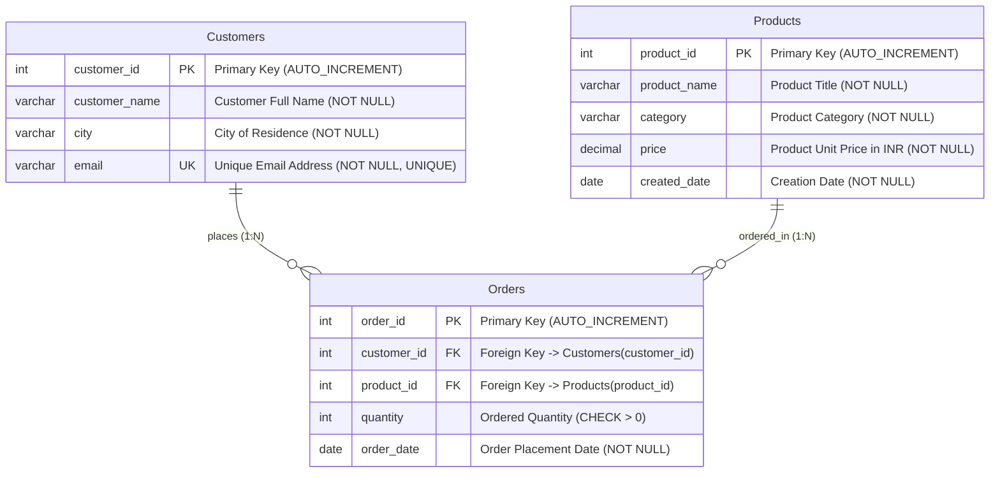
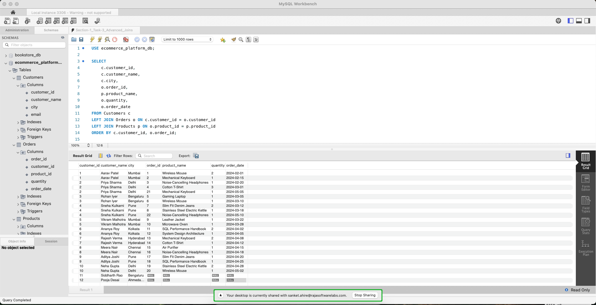
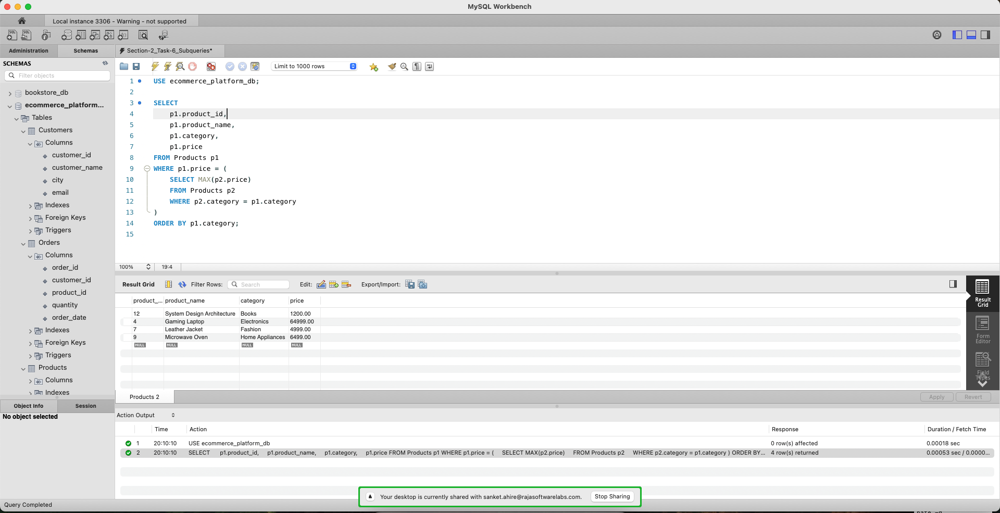

# Online Shopping Platform Database Modernization (SQL Advanced Assignment)

## Assignment Overview

### Problem Statement & Background
You have been assigned to work as a **Database Developer** for an online shopping platform. The platform manages customer, product, and order information in a relational database and has experienced rapid growth in both data volume and user activity.

As part of the database modernization initiative, the database developer is responsible for developing advanced SQL solutions that support:
- **Business Reporting & Sales Analytics:** Advanced multi-table joins, subqueries, and analytical window functions.
- **Data Virtualization & Modularity:** Common Table Expressions (CTEs) and database views.
- **Database Logic Automation:** Event-driven database triggers and stored routines.
- **Transactional Consistency:** ACID-compliant transactions with atomic rollback mechanisms.
- **Performance Optimization:** B-Tree indexing, execution plan analysis (`EXPLAIN`), and sargable query refactoring.

---

## Project Structure
```text
sql-advance-ecommerce-assignment-sanketahire/
├── .gitignore                          # Git ignore rules for OS, IDE, and DB tools
├── README.md                           # Master documentation, schema, and query catalog
├── ecommerce_advanced_management.sql   # Master SQL script (DDL, seed data, Tasks 1-20)
├── docs/                               # Assignment briefs and reference materials
│   ├── Training.Assignment.SQL (Advance).pdf
│   └── Training.Material.SQL (Advance).pdf
└── screenshots/                        # Milestone execution proofs
    ├── 01_advanced_join_task3.png
    ├── 02_subquery_task6.png
    ├── 03_window_functions_task9_10.png
    ├── 04_cte_task11_12.png
    ├── 05_view_task13.png
    ├── 06_stored_routine_task16_17.png
    ├── 07_trigger_execution_task19.png
    ├── 08_transaction_rollback_commit_task18.png
    └── 09_explain_query_plan_task15.png
```

---

## Database Schema & Architecture

### Entity-Relationship (ER) Diagram


---

### Data Dictionary

#### 1. `Customers` Table
| Column Name | Data Type | Constraints | Description |
| :--- | :--- | :--- | :--- |
| `customer_id` | `INT` | `PRIMARY KEY`, `AUTO_INCREMENT` | Unique identifier for each customer |
| `customer_name` | `VARCHAR(100)` | `NOT NULL` | Full name of the registered customer |
| `city` | `VARCHAR(50)` | `NOT NULL` | City of residence / shipping location |
| `email` | `VARCHAR(100)` | `NOT NULL`, `UNIQUE` | Distinct personal email address |

#### 2. `Products` Table
| Column Name | Data Type | Constraints | Description |
| :--- | :--- | :--- | :--- |
| `product_id` | `INT` | `PRIMARY KEY`, `AUTO_INCREMENT` | Unique identifier for each product item |
| `product_name` | `VARCHAR(100)` | `NOT NULL` | Descriptive commercial product name |
| `category` | `VARCHAR(50)` | `NOT NULL` | Departmental classification (`Electronics`, `Fashion`, etc.) |
| `price` | `DECIMAL(10,2)` | `NOT NULL` | Exact retail unit price in INR |
| `created_date` | `DATE` | `NOT NULL` | Date product was added to inventory (supports Task 20) |

#### 3. `Orders` Table
| Column Name | Data Type | Constraints | Description |
| :--- | :--- | :--- | :--- |
| `order_id` | `INT` | `PRIMARY KEY`, `AUTO_INCREMENT` | Unique transaction identifier |
| `customer_id` | `INT` | `FOREIGN KEY` $\rightarrow$ `Customers(customer_id)` | Customer placing the purchase (`ON DELETE CASCADE`) |
| `product_id` | `INT` | `FOREIGN KEY` $\rightarrow$ `Products(product_id)` | Product purchased (`ON DELETE CASCADE`) |
| `quantity` | `INT` | `NOT NULL`, `CHECK (quantity > 0)` | Number of units ordered |
| `order_date` | `DATE` | `NOT NULL` | Calendar date of transaction execution |

---

## Steps to Execute the SQL Script

### Option A: Using MySQL Workbench (GUI)
1. Launch **MySQL Workbench** and open your active MySQL Connection (`localhost:3306`).
2. Navigate to **File** $\rightarrow$ **Open SQL Script...** and select [`ecommerce_advanced_management.sql`](./ecommerce_advanced_management.sql).
3. Click the **Execute (⚡)** button on the toolbar to run the complete script.
4. Inspect the generated Result Grids across all query tabs.

### Option B: Using MySQL Terminal / Command Line (CLI)
1. Open your terminal and navigate to the project directory:
   ```bash
   cd sql-advance-ecommerce-assignment-sanketahire
   ```
2. Execute the master script directly into MySQL:
   ```bash
   mysql -u root -p < ecommerce_advanced_management.sql
   ```
3. Alternatively, launch the MySQL interactive shell and run:
   ```sql
   SOURCE ecommerce_advanced_management.sql;
   ```

---

## Query Catalog & Execution Results

### Section 1: Advanced Joins

#### Task 1: Display each customer along with the products they ordered
* **Description:** Multi-table relational query joining `Customers`, `Orders`, and `Products` to project purchase history for active customers.
* **SQL Query:**
  ```sql
  SELECT 
      c.customer_id,
      c.customer_name,
      p.product_name,
      p.category,
      o.quantity,
      o.order_date
  FROM Customers c
  INNER JOIN Orders o ON c.customer_id = o.customer_id
  INNER JOIN Products p ON o.product_id = p.product_id
  ORDER BY c.customer_id, o.order_id;
  ```
* **Execution Output:**
  | customer_id | customer_name | product_name | category | quantity | order_date |
  | :---: | :--- | :--- | :--- | :---: | :---: |
  | 1 | Aarav Patel | Wireless Mouse | Electronics | 2 | 2024-02-01 |
  | 1 | Aarav Patel | Mechanical Keyboard | Electronics | 1 | 2024-02-15 |
  | 2 | Priya Sharma | Noise-Cancelling Headphones | Electronics | 1 | 2024-02-20 |
  | 2 | Priya Sharma | Cotton T-Shirt | Fashion | 3 | 2024-03-01 |
  | 2 | Priya Sharma | Mechanical Keyboard | Electronics | 1 | 2024-05-05 |
  | 3 | Rohan Iyer | Gaming Laptop | Electronics | 1 | 2024-03-05 |
  | 3 | Rohan Iyer | Wireless Mouse | Electronics | 1 | 2024-03-10 |
  | 4 | Sneha Kulkarni | Slim Fit Denim Jeans | Fashion | 2 | 2024-03-12 |
  | 4 | Sneha Kulkarni | Stainless Steel Electric Kettle | Home Appliances | 1 | 2024-03-18 |
  | 4 | Sneha Kulkarni | Noise-Cancelling Headphones | Electronics | 1 | 2024-05-10 |
  | 5 | Vikram Malhotra | Leather Jacket | Fashion | 1 | 2024-03-22 |
  | 5 | Vikram Malhotra | Microwave Oven | Home Appliances | 1 | 2024-03-28 |
  | 6 | Ananya Roy | SQL Performance Handbook | Books | 2 | 2024-04-02 |
  | 6 | Ananya Roy | System Design Architecture | Books | 1 | 2024-04-05 |
  | 7 | Rajesh Verma | Mechanical Keyboard | Electronics | 2 | 2024-04-08 |
  | 7 | Rajesh Verma | Cotton T-Shirt | Fashion | 1 | 2024-04-12 |
  | 8 | Meera Nair | Air Purifier | Home Appliances | 1 | 2024-04-15 |
  | 8 | Meera Nair | Noise-Cancelling Headphones | Electronics | 1 | 2024-04-18 |
  | 9 | Aditya Joshi | Slim Fit Denim Jeans | Fashion | 1 | 2024-04-20 |
  | 9 | Aditya Joshi | SQL Performance Handbook | Books | 1 | 2024-04-25 |
  | 10 | Neha Gupta | Stainless Steel Electric Kettle | Home Appliances | 2 | 2024-04-28 |
  | 10 | Neha Gupta | Wireless Mouse | Electronics | 1 | 2024-05-02 |
  *(22 rows returned)*

#### Task 2: Display all possible combinations of customers and products using a CROSS JOIN
* **Description:** Computes the Cartesian Product ($12 \text{ Customers} \times 12 \text{ Products} = 144 \text{ rows}$) generating every potential customer-product pair without a join filter.
* **SQL Query:**
  ```sql
  SELECT 
      c.customer_id,
      c.customer_name,
      p.product_id,
      p.product_name,
      p.category,
      p.price
  FROM Customers c
  CROSS JOIN Products p
  ORDER BY c.customer_id, p.product_id;
  ```
* **Execution Output (Sample First 5 of 144 Rows):**
  | customer_id | customer_name | product_id | product_name | category | price |
  | :---: | :--- | :---: | :--- | :--- | :---: |
  | 1 | Aarav Patel | 1 | Wireless Mouse | Electronics | 799.00 |
  | 1 | Aarav Patel | 2 | Mechanical Keyboard | Electronics | 2499.00 |
  | 1 | Aarav Patel | 3 | Noise-Cancelling Headphones | Electronics | 7999.00 |
  | 1 | Aarav Patel | 4 | Gaming Laptop | Electronics | 64999.00 |
  | 1 | Aarav Patel | 5 | Cotton T-Shirt | Fashion | 499.00 |
  *(144 rows returned total)*

#### Task 3: Display all customers and their orders, including customers who have not placed any orders
* **Description:** Employs a `LEFT JOIN` starting from `Customers` to guarantee preservation of every customer record. Inactive customers (`customer_id` 11 and 12) evaluate to `NULL` for order and product columns.
* **SQL Query:**
  ```sql
  SELECT 
      c.customer_id,
      c.customer_name,
      c.city,
      o.order_id,
      p.product_name,
      o.quantity,
      o.order_date
  FROM Customers c
  LEFT JOIN Orders o ON c.customer_id = o.customer_id
  LEFT JOIN Products p ON o.product_id = p.product_id
  ORDER BY c.customer_id, o.order_id;
  ```
* **Execution Output:**
  | customer_id | customer_name | city | order_id | product_name | quantity | order_date |
  | :---: | :--- | :--- | :---: | :--- | :---: | :---: |
  | 1 | Aarav Patel | Mumbai | 1 | Wireless Mouse | 2 | 2024-02-01 |
  | 1 | Aarav Patel | Mumbai | 2 | Mechanical Keyboard | 1 | 2024-02-15 |
  | 2 | Priya Sharma | Delhi | 3 | Noise-Cancelling Headphones | 1 | 2024-02-20 |
  | 2 | Priya Sharma | Delhi | 4 | Cotton T-Shirt | 3 | 2024-03-01 |
  | 2 | Priya Sharma | Delhi | 21 | Mechanical Keyboard | 1 | 2024-05-05 |
  | 3 | Rohan Iyer | Bengaluru | 5 | Gaming Laptop | 1 | 2024-03-05 |
  | 3 | Rohan Iyer | Bengaluru | 6 | Wireless Mouse | 1 | 2024-03-10 |
  | 4 | Sneha Kulkarni | Pune | 7 | Slim Fit Denim Jeans | 2 | 2024-03-12 |
  | 4 | Sneha Kulkarni | Pune | 8 | Stainless Steel Electric Kettle | 1 | 2024-03-18 |
  | 4 | Sneha Kulkarni | Pune | 22 | Noise-Cancelling Headphones | 1 | 2024-05-10 |
  | 5 | Vikram Malhotra | Mumbai | 9 | Leather Jacket | 1 | 2024-03-22 |
  | 5 | Vikram Malhotra | Mumbai | 10 | Microwave Oven | 1 | 2024-03-28 |
  | 6 | Ananya Roy | Kolkata | 11 | SQL Performance Handbook | 2 | 2024-04-02 |
  | 6 | Ananya Roy | Kolkata | 12 | System Design Architecture | 1 | 2024-04-05 |
  | 7 | Rajesh Verma | Hyderabad | 13 | Mechanical Keyboard | 2 | 2024-04-08 |
  | 7 | Rajesh Verma | Hyderabad | 14 | Cotton T-Shirt | 1 | 2024-04-12 |
  | 8 | Meera Nair | Chennai | 15 | Air Purifier | 1 | 2024-04-15 |
  | 8 | Meera Nair | Chennai | 16 | Noise-Cancelling Headphones | 1 | 2024-04-18 |
  | 9 | Aditya Joshi | Pune | 17 | Slim Fit Denim Jeans | 1 | 2024-04-20 |
  | 9 | Aditya Joshi | Pune | 18 | SQL Performance Handbook | 1 | 2024-04-25 |
  | 10 | Neha Gupta | Delhi | 19 | Stainless Steel Electric Kettle | 2 | 2024-04-28 |
  | 10 | Neha Gupta | Delhi | 20 | Wireless Mouse | 1 | 2024-05-02 |
  | **11** | **Siddharth Rao** | **Bengaluru** | **NULL** | **NULL** | **NULL** | **NULL** |
  | **12** | **Pooja Desai** | **Ahmedabad** | **NULL** | **NULL** | **NULL** | **NULL** |
  *(24 rows returned)*

* **Execution Screenshot (Mandatory Deliverable 1 - Advanced Join Query):**
  

---

### Section 2: Subqueries

#### Task 4: Find products priced above the average product price
* **Description:** Employs an uncorrelated scalar subquery within the `WHERE` clause to compute the company-wide average product unit price (₹8,195.00) dynamically before filtering outer catalog items.
* **SQL Query:**
  ```sql
  SELECT 
      product_id, 
      product_name, 
      category, 
      price
  FROM Products
  WHERE price > (SELECT AVG(price) FROM Products)
  ORDER BY price DESC;
  ```
* **Execution Output:**
  | product_id | product_name | category | price |
  | :---: | :--- | :--- | :---: |
  | 4 | Gaming Laptop | Electronics | 64999.00 |
  *(1 row returned; catalog arithmetic mean is ₹8,195.00)*

#### Task 5: Display customers whose total purchase amount is greater than the average customer purchase amount
* **Description:** Leverages an aggregated subquery inside the `HAVING` clause to filter customers whose cumulative spend exceeds the company-wide average customer spend (₹13,342.50).
* **SQL Query:**
  ```sql
  SELECT 
      c.customer_id,
      c.customer_name,
      SUM(p.price * o.quantity) AS total_purchase_amount
  FROM Customers c
  INNER JOIN Orders o ON c.customer_id = o.customer_id
  INNER JOIN Products p ON o.product_id = p.product_id
  GROUP BY c.customer_id, c.customer_name
  HAVING total_purchase_amount > (
      SELECT AVG(customer_total)
      FROM (
          SELECT SUM(p2.price * o2.quantity) AS customer_total
          FROM Orders o2
          INNER JOIN Products p2 ON o2.product_id = p2.product_id
          GROUP BY o2.customer_id
      ) AS customer_spend_summary
  )
  ORDER BY total_purchase_amount DESC;
  ```
* **Execution Output:**
  | customer_id | customer_name | total_purchase_amount |
  | :---: | :--- | :---: |
  | 3 | Rohan Iyer | 65798.00 |
  *(1 row returned; average active customer spend is ₹13,342.50)*

#### Task 6: Find the highest-priced product in each category using a correlated subquery
* **Description:** Executes a correlated subquery where the inner `SELECT MAX(p2.price)` evaluates iteratively for each row in the outer query, binding on `p2.category = p1.category`.
* **SQL Query:**
  ```sql
  SELECT 
      p1.product_id,
      p1.product_name,
      p1.category,
      p1.price
  FROM Products p1
  WHERE p1.price = (
      SELECT MAX(p2.price)
      FROM Products p2
      WHERE p2.category = p1.category
  )
  ORDER BY p1.category;
  ```
* **Execution Output:**
  | product_id | product_name | category | price |
  | :---: | :--- | :--- | :---: |
  | 12 | System Design Architecture | Books | 1200.00 |
  | 4 | Gaming Laptop | Electronics | 64999.00 |
  | 7 | Leather Jacket | Fashion | 4999.00 |
  | 9 | Microwave Oven | Home Appliances | 6499.00 |
  *(4 rows returned — one category leader per department)*

* **Execution Screenshot (Mandatory Deliverable 2 - Subquery):**
  

---

### Section 3: Set Operations

#### Task 7: Combine products from two different categories using UNION
* **Description:** Unifies two independent `SELECT` projections from `Electronics` and `Fashion` categories. `UNION` automatically eliminates duplicate rows and standardizes schema alignment.
* **SQL Query:**
  ```sql
  SELECT 
      product_id, 
      product_name, 
      category, 
      price
  FROM Products
  WHERE category = 'Electronics'
  UNION
  SELECT 
      product_id, 
      product_name, 
      category, 
      price
  FROM Products
  WHERE category = 'Fashion'
  ORDER BY category, price;
  ```
* **Execution Output:**
  | product_id | product_name | category | price |
  | :---: | :--- | :--- | :---: |
  | 1 | Wireless Mouse | Electronics | 799.00 |
  | 2 | Mechanical Keyboard | Electronics | 2499.00 |
  | 3 | Noise-Cancelling Headphones | Electronics | 7999.00 |
  | 4 | Gaming Laptop | Electronics | 64999.00 |
  | 5 | Cotton T-Shirt | Fashion | 499.00 |
  | 6 | Slim Fit Denim Jeans | Fashion | 1899.00 |
  | 7 | Leather Jacket | Fashion | 4999.00 |
  *(7 rows returned)*

#### Task 8: Write MySQL alternatives for INTERSECT and EXCEPT using INNER JOIN and LEFT JOIN

##### Task 8A: MySQL INTERSECT Alternative (Finding Common Rows using INNER JOIN)
* **Description:** Simulates mathematical set intersection (`INTERSECT`) using an `INNER JOIN` on matching primary keys across two condition sets (`category = 'Electronics'` AND `price > 2000`).
* **SQL Query:**
  ```sql
  SELECT DISTINCT 
      p1.product_id, 
      p1.product_name, 
      p1.category, 
      p1.price
  FROM Products p1
  INNER JOIN Products p2 
      ON p1.product_id = p2.product_id
  WHERE p1.category = 'Electronics'
    AND p2.price > 2000
  ORDER BY p1.price;
  ```
* **Execution Output:**
  | product_id | product_name | category | price |
  | :---: | :--- | :--- | :---: |
  | 2 | Mechanical Keyboard | Electronics | 2499.00 |
  | 3 | Noise-Cancelling Headphones | Electronics | 7999.00 |
  | 4 | Gaming Laptop | Electronics | 64999.00 |
  *(3 common rows returned)*

##### Task 8B: MySQL EXCEPT Alternative (Finding Unique Rows using LEFT JOIN ... WHERE IS NULL)
* **Description:** Simulates mathematical set difference (`EXCEPT` / `MINUS`) using a `LEFT JOIN` combined with `WHERE right.id IS NULL`, returning rows in the first query that do not exist in the second query (i.e. Electronics products priced $\le ₹2,000$).
* **SQL Query:**
  ```sql
  SELECT DISTINCT 
      p1.product_id, 
      p1.product_name, 
      p1.category, 
      p1.price
  FROM Products p1
  LEFT JOIN Products p2 
      ON p1.product_id = p2.product_id
     AND p2.price > 2000
  WHERE p1.category = 'Electronics'
    AND p2.product_id IS NULL
  ORDER BY p1.price;
  ```
* **Execution Output:**
  | product_id | product_name | category | price |
  | :---: | :--- | :--- | :---: |
  | 1 | Wireless Mouse | Electronics | 799.00 |
  *(1 distinct row returned — Electronics item priced <= 2000)*
