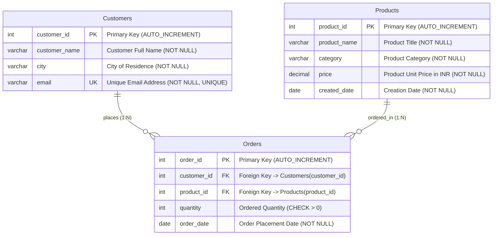

# Online Shopping Platform Database Modernization (SQL Advanced Assignment)

## Assignment Overview

### Problem Statement & Background
You have been assigned to work as a **Database Developer** for an online shopping platform. The platform manages customer, product, and order information in a relational database and has experienced rapid growth in both data volume and user activity.

As part of the database modernization initiative, the database developer is responsible for developing advanced SQL solutions that support:
- **Business Reporting & Sales Analytics:** Advanced multi-table joins, subqueries, and analytical window functions.
- **Data Virtualization & Modularity:** Common Table Expressions (CTEs) and database views.
- **Database Logic Automation:** Event-driven database triggers and stored routines.
- **Transactional Consistency:** ACID-compliant transactions with atomic rollback mechanisms.
- **Performance Optimization:** B-Tree indexing, execution plan analysis (`EXPLAIN`), and sargable query refactoring.

---

## Project Structure
```text
sql-advance-ecommerce-assignment-sanketahire/
├── .gitignore                          # Git ignore rules for OS, IDE, and DB tools
├── README.md                           # Master documentation, schema, and query catalog
├── ecommerce_advanced_management.sql   # Master SQL script (DDL, seed data, Tasks 1-20)
├── docs/                               # Assignment briefs and reference materials
│   ├── Training.Assignment.SQL (Advance).pdf
│   └── Training.Material.SQL (Advance).pdf
└── screenshots/                        # Milestone execution proofs
    ├── 01_advanced_join_task3.png
    ├── 02_subquery_task6.png
    ├── 03_window_functions_task9_10.png
    ├── 04_cte_task11_12.png
    ├── 05_view_task13.png
    ├── 06_stored_routine_task16_17.png
    ├── 07_trigger_execution_task19.png
    ├── 08_transaction_rollback_commit_task18.png
    └── 09_explain_query_plan_task15.png
```

---

## Database Schema & Architecture

### Entity-Relationship (ER) Diagram


---

### Data Dictionary

#### 1. `Customers` Table
| Column Name | Data Type | Constraints | Description |
| :--- | :--- | :--- | :--- |
| `customer_id` | `INT` | `PRIMARY KEY`, `AUTO_INCREMENT` | Unique identifier for each customer |
| `customer_name` | `VARCHAR(100)` | `NOT NULL` | Full name of the registered customer |
| `city` | `VARCHAR(50)` | `NOT NULL` | City of residence / shipping location |
| `email` | `VARCHAR(100)` | `NOT NULL`, `UNIQUE` | Distinct personal email address |

#### 2. `Products` Table
| Column Name | Data Type | Constraints | Description |
| :--- | :--- | :--- | :--- |
| `product_id` | `INT` | `PRIMARY KEY`, `AUTO_INCREMENT` | Unique identifier for each product item |
| `product_name` | `VARCHAR(100)` | `NOT NULL` | Descriptive commercial product name |
| `category` | `VARCHAR(50)` | `NOT NULL` | Departmental classification (`Electronics`, `Fashion`, etc.) |
| `price` | `DECIMAL(10,2)` | `NOT NULL` | Exact retail unit price in INR |
| `created_date` | `DATE` | `NOT NULL` | Date product was added to inventory (supports Task 20) |

#### 3. `Orders` Table
| Column Name | Data Type | Constraints | Description |
| :--- | :--- | :--- | :--- |
| `order_id` | `INT` | `PRIMARY KEY`, `AUTO_INCREMENT` | Unique transaction identifier |
| `customer_id` | `INT` | `FOREIGN KEY` $\rightarrow$ `Customers(customer_id)` | Customer placing the purchase (`ON DELETE CASCADE`) |
| `product_id` | `INT` | `FOREIGN KEY` $\rightarrow$ `Products(product_id)` | Product purchased (`ON DELETE CASCADE`) |
| `quantity` | `INT` | `NOT NULL`, `CHECK (quantity > 0)` | Number of units ordered |
| `order_date` | `DATE` | `NOT NULL` | Calendar date of transaction execution |

---

## Steps to Execute the SQL Script

### Option A: Using MySQL Workbench (GUI)
1. Launch **MySQL Workbench** and open your active MySQL Connection (`localhost:3306`).
2. Navigate to **File** $\rightarrow$ **Open SQL Script...** and select [`ecommerce_advanced_management.sql`](./ecommerce_advanced_management.sql).
3. Click the **Execute (⚡)** button on the toolbar to run the complete script.
4. Inspect the generated Result Grids across all query tabs.

### Option B: Using MySQL Terminal / Command Line (CLI)
1. Open your terminal and navigate to the project directory:
   ```bash
   cd sql-advance-ecommerce-assignment-sanketahire
   ```
2. Execute the master script directly into MySQL:
   ```bash
   mysql -u root -p < ecommerce_advanced_management.sql
   ```
3. Alternatively, launch the MySQL interactive shell and run:
   ```sql
   SOURCE ecommerce_advanced_management.sql;
   ```

---

## Query Catalog & Execution Results
*(This catalog will expand incrementally as each section's tasks are implemented and verified).*
